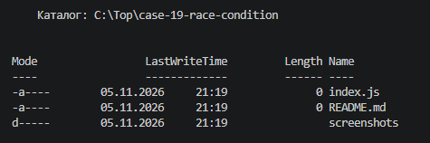
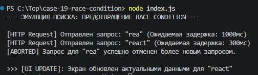

# Практическая работа: Анализ Pull Request — Кейс №19: Предотвращение Race Condition через AbortController

## Описание проекта

В рамках данной практической работы проведен глубокий инженерный анализ продакшен-инцидента, связанного с состоянием гонки (Race Condition) в механизме живого поиска (Search Autocomplete). Реализовано отказоустойчивое решение на базе стандарта `AbortController` как в виде изолированного Vanilla JS сервиса, так и в виде React-компонента с функцией очистки эффекта (`useEffect cleanup`).

---

## 1. Архитектурный анализ проблемы (Кейс №19)

### Описание инцидента в продакшене
Пользователь вводит в поле поиска строку `"react"`, затем стирает её и вводит `"vue"`. 
Сетевой запрос для `"vue"` выполняется быстро (200 мс), и экран отображает релевантные результаты. Однако более ранний запрос для `"react"` выполнялся на сервере дольше (1200 мс) и возвращается позже. В результате интерфейс перезаписывается устаревшими данными: в инпуте отображается `"vue"`, а в выпадающем списке — результаты для `"react"`.

### Физика сбоя
Сетевые запросы по протоколу HTTP асинхронны и не гарантируют очередность доставки ответов (FIFO):

```text
t = 0ms    [Запрос 1: "rea"]   --------------------(Задержка 1200мс)-------------------> [Ответ 1 получен: t = 1200ms]
t = 200ms  [Запрос 2: "react"] --------(Задержка 200мс)--------> [Ответ 2: t = 400ms]
                                                                  UI: "react"            UI затерт: "rea" (БАГ!)
```

Без программной отмены предыдущих вызовов каждый последующий ответ перезаписывает общее состояние приложения независимо от его актуальности.

---

## 2. Архитектура решения на базе AbortController

Браузерный API **`AbortController`** позволяет прерывать асинхронные операции и сетевые запросы `fetch` на уровне сетевого стека до момента их завершения.

### Принцип работы:
1. Перед отправкой нового запроса проверяется наличие ссылки на активный контроллер.
2. Если предыдущий запрос еще выполняется, вызывается метод `activeController.abort()`.
3. Создается новый экземпляр `new AbortController()`, а его свойство `signal` передается в параметры запроса `fetch`.
4. Браузер отклоняет отмененный промис с ошибкой `AbortError`. В блоке `catch` эта ошибка идентифицируется как штатная отмена и не отображается пользователю.

---

## 3. Структура проекта

```text
case-19-race-condition/
├── screenshots/
│   ├── 01-project-setup.png       # Скриншот структуры файлов стенда
│   └── 02-execution-result.png    # Скриншот вывода терминала с отменой устаревшего запроса
├── index.js                       # Эмуляция асинхронного поиска с отменой через AbortController
├── package.json                   # Конфигурация стенда ("type": "module")
└── README.md                      # Инженерный отчет и разбор кейса
```

---

## 4. Разбор реализации

### 4.1. Изолированная фабрика сервиса поиска (`index.js`)

```javascript
export function createSearchService() {
  let activeAbortController = null;

  return async function search(query, mockDelay) {
    // 1. Отмена устаревшего активного запроса
    if (activeAbortController) {
      activeAbortController.abort();
    }

    // 2. Создание нового контроллера
    activeAbortController = new AbortController();
    const { signal } = activeAbortController;

    try {
      const response = await mockSearchApi(query, mockDelay, signal);
      activeAbortController = null;
      return response;
    } catch (error) {
      // 3. Штатная фильтрация отмененных вызовов
      if (error.name === "AbortError") {
        console.log(`[ABORTED] Запрос для "${query}" отменен.`);
        return null;
      }
      activeAbortController = null;
      throw error;
    }
  };
}
```

* **Замыкание:** Переменная `activeAbortController` инкапсулирована внутри функции-фабрики и защищена от внешних мутаций.
* **Изоляция ошибок:** Исключение типа `AbortError` перехватывается без разрушения цепочки выполнения и возвращает `null`.

---

### 4.2. Интеграция в React через `useEffect` Cleanup

В компонентной модели React отмена запроса инкапсулируется в функцию очистки хука `useEffect`:

```jsx
import { useState, useEffect } from "react";

export function SearchDropdown() {
  const [query, setQuery] = useState("");
  const [results, setResults] = useState([]);
  const [isLoading, setIsLoading] = useState(false);

  useEffect(() => {
    if (!query.trim()) {
      setResults([]);
      setIsLoading(false);
      return;
    }

    const controller = new AbortController();

    async function fetchData() {
      setIsLoading(true);
      try {
        const response = await fetch(`/api/search?q=${encodeURIComponent(query)}`, {
          signal: controller.signal,
        });
        const data = await response.json();
        setResults(data);
      } catch (err) {
        if (err.name !== "AbortError") {
          console.error("Ошибка запроса:", err);
        }
      } finally {
        if (!controller.signal.aborted) {
          setIsLoading(false);
        }
      }
    }

    fetchData();

    // Функция очистки: вызывается перед следующим рендером или при размонтировании
    return () => {
      controller.abort();
    };
  }, [query]);

  return (
    <div>
      <input value={query} onChange={(e) => setQuery(e.target.value)} />
      {isLoading && <span>Поиск...</span>}
      <ul>
        {results.map((item) => (
          <li key={item.id}>{item.title}</li>
        ))}
      </ul>
    </div>
  );
}
```

---

## 5. Результаты выполнения и скриншоты

### 5.1. Структура стенда разработки
На снимке представлена конфигурация проекта, манифест `package.json` с поддержкой ESM и файлы модулей.



### 5.2. Верификация отмены состояния гонки
На скриншоте виден лог терминала: при отправке более нового запроса `"react"` фоновый медленный запрос `"rea"` мгновенно маркируется как `[ABORTED]`, а интерфейс обновляется исключительно актуальными данными.



---

## 6. Запуск стенда

1. Установка и запуск скрипта верификации:
   ```bash
   node index.js
   ```