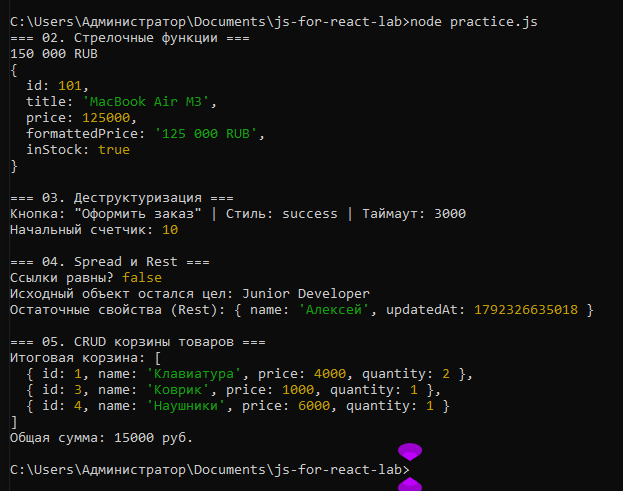

# Практическая работа №3: Основы современного JavaScript для React

## 📸 Результат выполнения (Скриншот)

Ниже представлен вывод работы программы в среде Node.js при запуске команды `node practice.js`:

## 📋 Описание выполненных разделов

### 02. Стрелочные функции и неявный возврат объектов
- Реализована функция форматирования цены `formatCurrency`.
- Реализована функция-генератор `createProduct` с неявным возвратом объекта (`({ ... })`). Скобки необходимы, чтобы интерпретатор не воспринимал фигурные скобки как тело функции.

### 03. Деструктуризация объектов и массивов
- Реализована функция `renderButtonProps` с глубокой деструктуризацией параметров и дефолтными значениями (`variant = "primary"`).
- Реализован эмулятор хука React — `mockUseState`, демонстрирующий возврат кортежа `[state, setState]` и деструктуризацию массива.

### 04. Spread и Rest: Иммутабельное обновление объектов
- Выполнено обновление пользователя без прямой мутации исходного объекта с помощью Spread-оператора (`...initialUser`).
- Проверена ссылочная идентичность через `initialUser === promotedUser` (`false`), что гарантирует корректную работу алгоритмов сравнения в React.
- Использован Rest-оператор для исключения служебных полей и сбора остаточных свойств в `displayData`.

### 05. Иммутабельные операции с массивами (CRUD корзины)
- **Добавление (Add):** добавление нового товара через spread-оператор (`[...initialCart, newItem]`).
- **Удаление (Delete):** удаление позиции по `id` с помощью метода `.filter()`.
- **Обновление (Update):** изменение количества товара через метод `.map()` с сохранением неизменности остальных элементов.
- **Подсчет суммы (Compute total):** вычисление общей стоимости корзины с помощью `.reduce()`.
