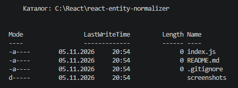
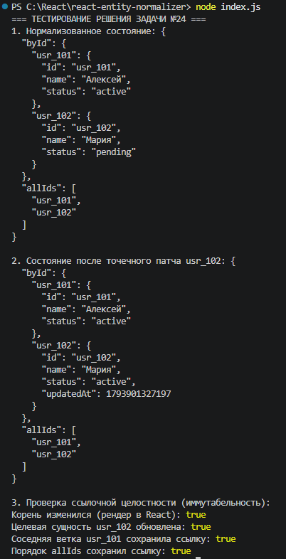

# Практическая работа: Архитектура состояния в React и нормализация сущностей (Задача №24)

Данный проект посвящен оптимизации управления состоянием фронтенд-приложений (React, Redux, Zustand) путем перехода от линейных плоских списков к нормализованной структуре `byId` и `allIds`. Рассматривается реализация иммутабельного точечного обновления данных за константное время $O(1)$ с сохранением ссылочной изоляции.

---

## Содержание

1. [Архитектурная проблема и предпосылки](#архитектурная-проблема-и-предпосылки)
2. [Архитектура нормализации (byId & allIds)](#архитектура-нормализации-byid--allids)
3. [Структура проекта](#структура-проекта)
4. [Разбор исходного кода](#разбор-исходного-кода)
   * [Функция normalizeEntities](#1-функция-normalizeentities)
   * [Функция patchEntityById](#2-функция-patchentitybyid)
   * [Функция removeEntityById](#3-функция-removeentitybyid)
5. [Верификация ссылочной целостности](#верификация-ссылочной-целостности)
6. [Скриншоты выполнения](#скриншоты-выполнения)
7. [Инструкция по установке и запуску](#инструкция-по-установке-и-запуску)

---

## Архитектурная проблема и предпосылки

В типичных REST API ответы сервера возвращаются клиенту в виде плоских массивов:

```javascript
const rawUsers = [
  { id: "usr_1", name: "Анна", role: "admin" },
  { id: "usr_2", name: "Борис", role: "editor" }
];
```

Прямое сохранение подобного массива в React-стейт влечет ряд проблем:
1. **Сложность $O(N)$ при обновлении:** Чтобы изменить данные одного элемента, требуется обойти весь массив через `.map()`.
2. **Сложность $O(N)$ при удалении:** Для исключения элемента требуется фильтрация `.filter()`.
3. **Нарушение ссылочной изоляции:** При неаккуратном копировании массива пересоздаются ссылки у соседних объектов, что приводит к лишним повторным рендерам мемоизированных компонентов (`React.memo`).

---

## Архитектура нормализации (byId & allIds)

Для решения указанных проблем данные разделяются на две структуры:
* **`byId`**: Хэш-таблица (объект-словарь `Record<string, Entity>`), где ключом выступает уникальный идентификатор сущности. Доступ, чтение и точечное обновление осуществляются за время $O(1)$.
* **`allIds`**: Упорядоченный массив идентификаторов (`string[]`), сохраняющий строгий порядок вывода сущностей в пользовательском интерфейсе.

```text
normalizedState
├── byId
│   ├── usr_101: { id: "usr_101", name: "Алексей", status: "active" }
│   └── usr_102: { id: "usr_102", name: "Мария", status: "pending" }
└── allIds: ["usr_101", "usr_102"]
```

---

## Структура проекта

```text
react-entity-normalizer/
├── screenshots/
│   ├── 01-project-setup.png       # Скриншот структуры файлов стенда
│   └── 02-execution-result.png    # Скриншот вывода терминала с проверкой ссылок
├── .gitignore                     # Исключение node_modules и системных файлов
├── index.js                       # Реализация нормализатора и блока верификации
├── package.json                   # Конфигурация проекта с флагом "type": "module"
└── README.md                      # Документация практической работы
```

---

## Разбор исходного кода

### 1. Функция `normalizeEntities`
Конвертирует входящий массив объектов в структуру с хэш-таблицей и индексным массивом.

```javascript
export function normalizeEntities(array) {
  if (!Array.isArray(array)) {
    throw new TypeError("Входной параметр должен быть массивом");
  }

  return {
    byId: Object.fromEntries(array.map((item) => [item.id, { ...item }])),
    allIds: array.map((item) => item.id),
  };
}
```

* **Логика:** Метод `Object.fromEntries` создает словарь из пар `[id, object]`. Каждый объект поверхностно клонируется (`{ ...item }`), защищая исходные входные данные от внешних мутаций.

---

### 2. Функция `patchEntityById`
Выполняет точечную модификацию полей конкретной записи за время $O(1)$.

```javascript
export function patchEntityById(state, id, patch) {
  const currentEntity = state.byId[id];

  if (!currentEntity) {
    console.warn(`Сущность с ID "${id}" не найдена.`);
    return state;
  }

  return {
    ...state,
    byId: {
      ...state.byId,
      [id]: {
        ...currentEntity,
        ...patch,
        updatedAt: Date.now(),
      },
    },
    // allIds не изменяется — ссылка на массив сохраняется старой
  };
}
```

* **Логика:** Поиск целевого объекта в словаре `state.byId[id]` происходит мгновенно ($O(1)$). При обновлении создается новый объект состояния и новый словарь `byId`, но ссылка на массив `allIds` и ссылки на неизмененные соседние элементы остаются прежними.

---

### 3. Функция `removeEntityById`
Удаляет сущность из словаря без применения мутирующего оператора `delete`.

```javascript
export function removeEntityById(state, idToDelete) {
  if (!state.byId[idToDelete]) {
    return state;
  }

  const { [idToDelete]: removed, ...remainingById } = state.byId;

  return {
    byId: remainingById,
    allIds: state.allIds.filter((id) => id !== idToDelete),
  };
}
```

* **Логика:** Использование вычисляемого свойства с Rest-деструктуризацией (`const { [idToDelete]: removed, ...remainingById } = state.byId`) исключает ключ из словаря иммутабельно, возвращая новый объект `remainingById`.

---

## Верификация ссылочной целостности

Для проверки корректности работы со ссылками в памяти запускаются следующие проверки:

```javascript
// 1. Инициализация нормализованного состояния
const rawData = [
  { id: "usr_101", name: "Алексей", status: "active" },
  { id: "usr_102", name: "Мария", status: "pending" },
];
const normalizedState = normalizeEntities(rawData);

// 2. Точечное обновление сущности usr_102
const nextState = patchEntityById(normalizedState, "usr_102", { status: "active" });

// 3. Тесты равенства ссылок:
console.log(normalizedState !== nextState);
// true -> Ссылка на корень обновилась (React перерендерит контейнер)

console.log(normalizedState.byId["usr_102"] !== nextState.byId["usr_102"]);
// true -> Целевой объект получил новую ссылку в памяти

console.log(normalizedState.byId["usr_101"] === nextState.byId["usr_101"]);
// true -> Соседний объект usr_101 сохранил прежнюю ссылку (React.memo не будет его перерисовывать)

console.log(normalizedState.allIds === nextState.allIds);
// true -> Массив порядка элементов не затронут, ссылка не менялась
```

---

## Скриншоты выполнения

### 1. Подготовка стенда и структура файлов
На скриншоте отображена корневая директория проекта, созданные файлы модулей и манифест `package.json`.



---

### 2. Вывод результатов и верификация ссылок
На скриншоте зафиксирован вывод в терминале при запуске скрипта: корректные структуры данных и четыре проверки ссылочной целостности со значением `true`.



---

## Инструкция по установке и запуску

1. **Клонирование репозитория:**
   ```bash
   git clone https://github.com/<ваш-логин>/react-entity-normalizer.git
   cd react-entity-normalizer
   ```

2. **Запуск скрипта:**
   ```bash
   node index.js
   ```