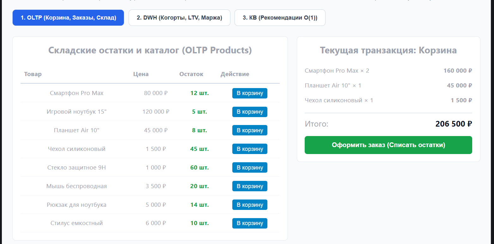
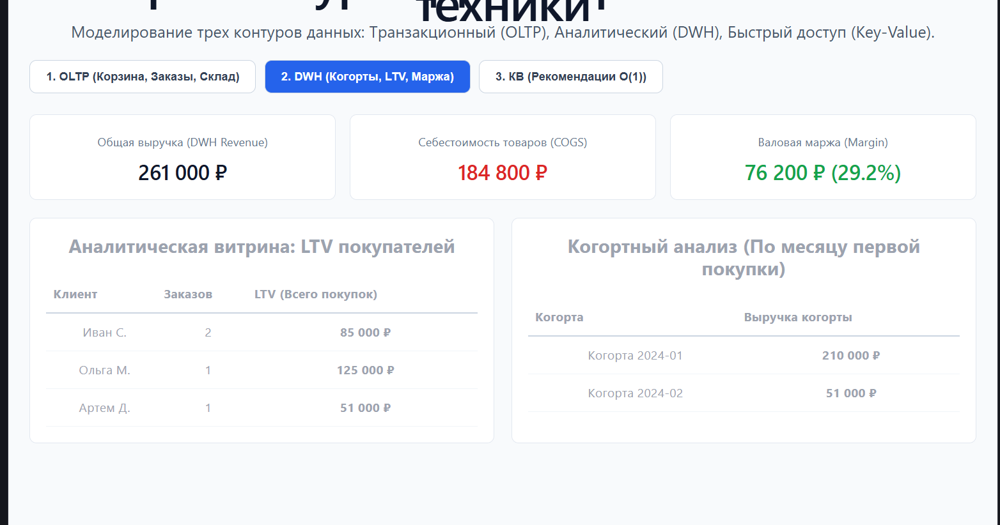

# Архитектура данных интернет-магазина техники (OLTP, DWH, Key-Value)

Практическая работа демонстрирует разделение контуров хранения и обработки данных в масштабируемом интернет-магазине электроники.

---

## Архитектура контуров данных

1. **OLTP (Транзакционный контур):**
   * Обеспечивает строгую консистентность (ACID).
   * Реализует логику корзины, создание заказов и моментальное списание складских остатков (`stock`).

2. **DWH (Аналитическое хранилище):**
   * Агрегирует исторические срезы данных без блокировки транзакционной БД.
   * Рассчитывает ключевые бизнес-показатели: **LTV** (пожизненная ценность клиента), когортный анализ по дате первой покупки и чистую **маржинальность** (Выручка − Себестоимость).

3. **КВ (Key-Value кэш / Redis-модель):**
   * Предоставляет доступ к рекомендациям сопутствующих товаров за константное время $O(1)$ по ключу `productId`.

---

## Результаты выполнения и скриншоты

### 1. OLTP: Корзина, заказы и списание остатков


### 2. DWH: Когортный анализ, LTV и маржинальность


### 3. Key-Value: Мгновенная выдача рекомендаций сопутствующих аксессуаров


---

## Запуск проекта
```bash
npm install
npm run dev
